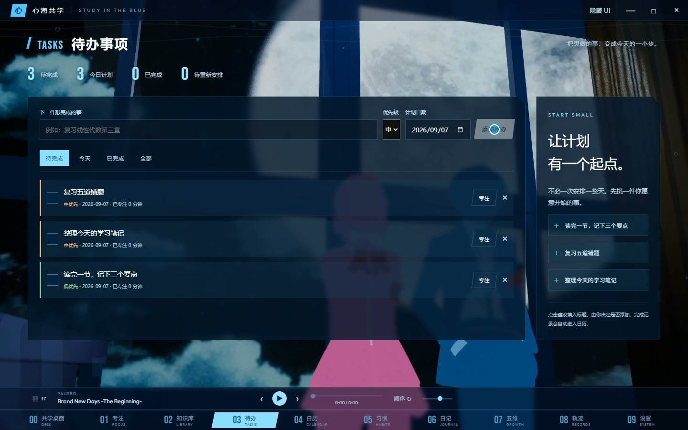
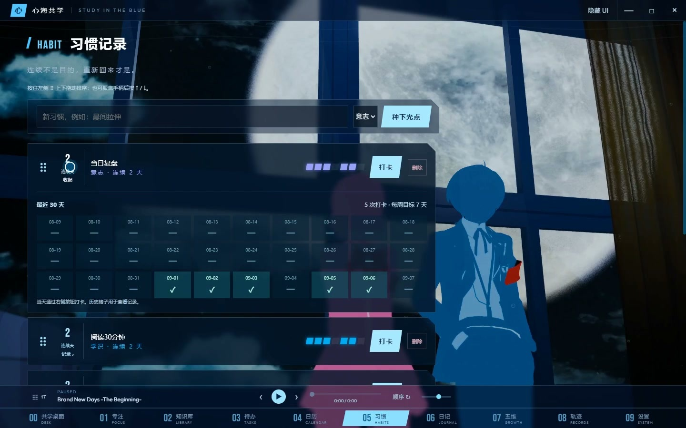
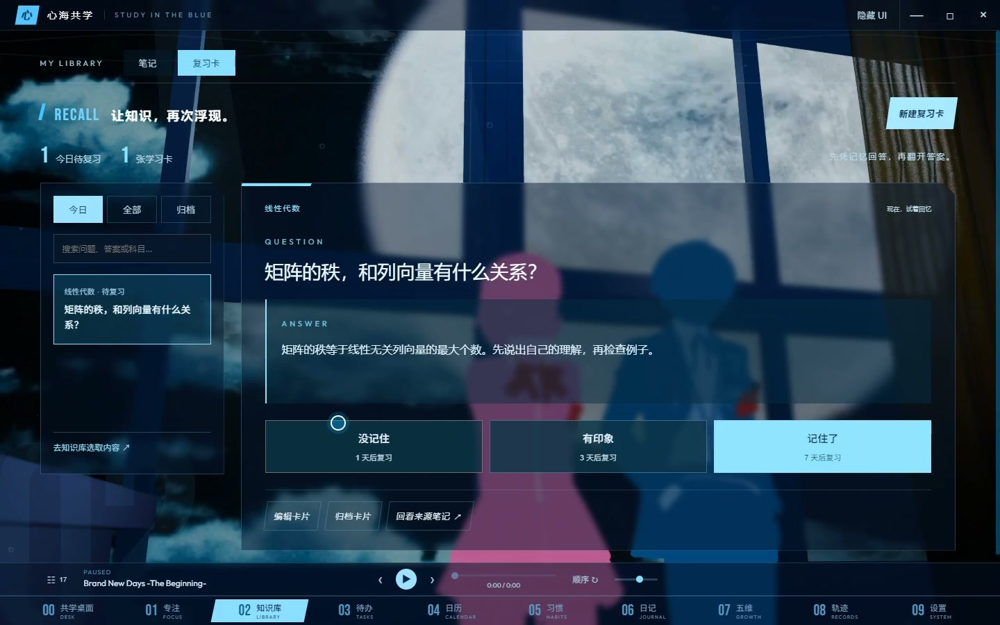

# 心海共学

**Study in the Blue**

把 P3R 里那些平凡日子的成长感，带回电脑前。

一款还在认真打磨的 Windows 学习陪伴工具。

## 想送给同好的一份小礼物

我很喜欢 Persona 里的一种感觉：明明只是读了书、和人聊了天，回头看，却发现自己已经悄悄往前走了一点。

于是我想，能不能把这种感觉放进平时学习的桌面里？

心海共学就是这样一点点做出来的。它有专注计时，也有待办、习惯、笔记和复习卡。你可以放一首喜欢的歌，选一个愿意待着的场景，先把今天的一件小事做完。完成之后，让音符响一下，让今天留下点痕迹。

它不会替你学习，也没有什么坚持几天就能改变人生的承诺。我只是希望，在某个不太想开始的晚上，它能让你愿意多坐下来一会儿。

## 现在能做什么

| 想做的事 | 心海共学里有什么 |
|---|---|
| 今天先开始一点 | 待办、优先级、计划日期，从任务直接进入专注 |
| 给学习留出时间 | 番茄钟、正计时、暂停与完成记录 |
| 看见一点成长 | 音符反馈，学识、意志、表达、体贴、灵巧五个维度 |
| 让习惯按自己的节奏来 | 打卡、历史回看、拖动排序、删除与撤销 |
| 别把学过的都忘了 | 本地 Markdown 笔记、Obsidian 仓库入口、间隔复习卡 |
| 回头看看这一天 | 日历整合任务、专注、打卡、日记和安排 |
| 给桌面一点陪伴感 | 音乐歌单、本地音乐导入、背景与人物调整 |

还有一个留在特定日子里的小彩蛋。这个就先不剧透了。

### 先把目标缩小一点

“复习五道错题”比“今天一定要努力”更容易开始。任务和专注可以接在一起，投入过的时间会留下记录。

### 断了一天，也能继续

习惯可以换顺序，也可以删掉不再适合自己的。删掉一个习惯，不会把过去的打卡和成长一起抹掉。

### 学到的东西，放在自己手里

笔记是本地 Markdown 文件，复习卡就在知识库里。先试着回答，再翻开答案，让下一次复习有个约定。

## 关于下载，先说明白

**这里是公开的项目展示仓库，目前没有公开安装包，也不是可以直接构建的完整源码仓库。**

0.1.9 已经做成 Windows 安装包，并在作者的私有仓库留存。因为使用的第三方角色、音乐和背景等内容还需要逐项整理使用范围，公开下载暂时没有放出来。后续如果提供公开版本，会在这个仓库写清楚。

## 想了解得更细一点

- [项目说明书](docs/项目说明.md)（[PDF 排版版](docs/项目说明书.pdf)）：功能、设计思路、技术架构、数据保存和目前的限制。
- [素材来源与鸣谢](CREDITS.md)：按实际收集记录保留作者与来源。
- [反馈一个问题](https://github.com/eighteclipses/xinhai/issues)：告诉我版本、操作步骤、原本期待的结果和实际发生的情况。

目前的技术栈是 Electron、React、TypeScript、Zustand 和 SQLite。基本学习工具可以离线使用；只有主动配置云模型评分时，相关日记内容才会发送到用户自己选择的服务。

这是非官方同人作品，与 SEGA / ATLUS 没有官方隶属或授权背书。Persona 相关角色、音乐与游戏画面归各自权利人所有。软件实现与资料整理使用了 AI 辅助；第三方素材的署名不代表再分发授权。

## 接下来，先把日常使用做好

我想优先完善备份与恢复、更多窗口尺寸下的操作，以及任务、笔记和复习之间的衔接。比起继续往导航栏里塞功能，更希望已经做出来的每一步都顺手。

如果你愿意提建议，可以直接说具体一点：哪个地方让你多点了几下，哪一段动画太急，或者哪个按钮不太好找。这些反馈会比一句“挺好看的”更有帮助。

## 如果你也喜欢这个方向

欢迎点一颗 **Star**，把这个小项目留在你的列表里。

它不会解锁下载，也不是更新的交换条件。只是看到有人和我一样，喜欢把日常的积累认真记下来，我会更有动力把它慢慢做好。

从 B 站视频过来的朋友，也谢谢你愿意看到这里。视频喜欢的话，点个赞、投个币、收藏一下就很开心了；有想法，评论区或 Issues 见。

---

心海共学 · 0.1.9  
从今天的一件小事开始。
