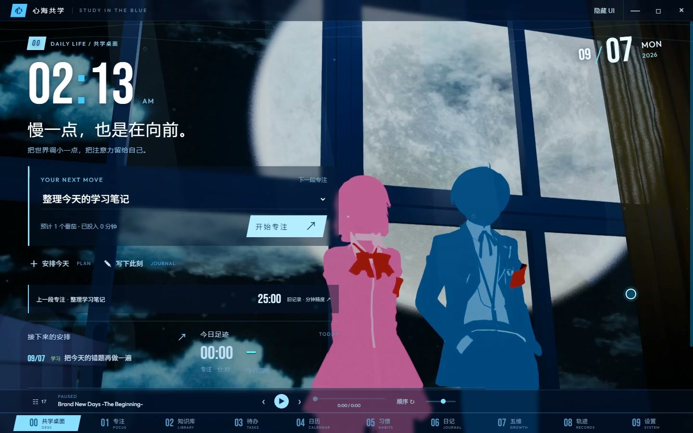

# 心海共学

**Study in the Blue**

把喜欢的场景、音乐和每天一点点的成长，留在同一张学习桌面。

Windows / Android 横屏平板 · 个人版 **0.2.35**

[下载安装包](https://github.com/eighteclipses/xinhai/releases) · [浏览完整源码](source) · [下载源码 ZIP](https://github.com/eighteclipses/xinhai/archive/refs/heads/main.zip) · [反馈问题](https://github.com/eighteclipses/xinhai/issues)

## 下载与源码

- **日常使用**：进入 [GitHub Releases](https://github.com/eighteclipses/xinhai/releases)，选择 0.2.35 的 Windows 安装程序或便携 ZIP；Android 文件以各次 Release 实际附带内容为准，本补丁未做新的实体平板验收。个人安装包保留作者自用的完整多壁纸、角色、音乐与语音内容。下载前查看该版本的说明及文件校验值。
- **研究与自行构建**：进入 [source/](source)，或下载上方源码 ZIP 后进入其中的 `source/` 目录。这里提供实际应用代码、Android 容器和构建配置；[构建步骤](source/BUILD.md) 与 [检查记录](source/docs/source-validation.md) 单独列出。
- 百度网盘：**【稍后由作者补充百度网盘链接】**。

源码快照的版本是 `0.2.35-source.0`。它使用独立资料目录与 Android 包名，并内置中性 SVG 示例背景。游戏角色、壁纸、视频、音乐、语音、字体与播放器皮肤没有放进源码仓库，因此自行构建后的默认画面与完整个人安装包不同。

## 从 0.2.27 升级后的变化

- 0.2.35 让添加音乐、添加文件夹、存放位置和移除/撤销直接出现在歌曲页；完整个人版还可隐藏/恢复内置歌曲。设置与公告提供电脑安装版、便携版更新指引。
- 0.2.34 修复深色设置表单黑字，简化专注说明并显示距下一个音符的时间；后台计时与领取方式可直接前往设置。公告逐版列出 0.2.28 至今的累计更新。
- 专注面板统一为半透明与主题色微光，可自由拖动、等比缩放、保存、取消和恢复默认；到时提示移到角落，成长演出期间延后显示。
- 每累计 25 分钟有效专注获得一个学习音符，余数跨次保留，例如 15 + 10 分钟可获得一个；可在结束本次时集中收下。旧学习记录和旧成长不重算。
- 可选择后台到时后停住等待，或继续休息与下一阶段。Android 设置页提供通知、准时提醒和后台运行限制入口。不同设备的后台限制仍需分别检查，不能保证所有系统都准时唤醒。
- 自定义页加入分组入口和关键词查找，写清桌面布局、学习分类、专注与声音设置的位置；完整个人版的人物库可以直接开关立绘，保留原选择、位置和大小。
- 保留三位可选角色及服装差分、每张壁纸独立配色、笔记改名/删除、日记删除、自定义学习分类、日历明细和按任务累计专注统计。

## 从哪里调整

| 想做的事 | 入口 |
|---|---|
| 换壁纸、取色、固定主题色、时钟/播放器外观、壁纸轮换 | **10 自定义**；可用顶部搜索快速定位 |
| 开关人物、选择服装、调整立绘位置和大小 | 完整个人版 **10 自定义 → 人物库** |
| 拖动、缩放或恢复首页模块 | **00 共学桌面** 顶部的小铅笔“编辑布局” |
| 新增科目/项目、改名与颜色、排序、停用或恢复分类 | **08 成长轨迹 → 学习分类** |
| 后台计时、音符集中演出、Android 提醒权限 | **09 系统设置 → 专注与音符** |
| 角色语音、自动播放、提示音量 | **09 系统设置 → 声音与体验** |

## 学习与资料

应用提供专注计时、待办、习惯、日历、日记回响、Markdown 知识库、复习卡片和五维成长。学习记录主要保存在本机；完整备份和局域网同步都是可选功能。升级前建议先在软件内导出完整备份，并保留原文件。

日记可使用本地规则分析；个人版也保留自带 API Key 的模型分析。只有主动选择模型分析时，当前正文才会发送给保存的模型服务，并可能产生服务费用。不要把自己的密钥、学习库、备份或局域网配对资料提交到 GitHub。

## 许可与素材

本项目是受 Persona 系列界面设计启发的非官方粉丝项目，与 ATLUS、SEGA 无隶属、合作或背书关系。

作者拥有权利的源码采用 [PolyForm Noncommercial 1.0.0](source/LICENSE)。这是带非商业用途限制的源码许可，**不等同于 OSI 定义的开源**。第三方代码继续保留其原许可，参见 [NOTICE](source/NOTICE) 和 [第三方说明](source/THIRD-PARTY-NOTICES.md)。原有许可证文本没有改动。

角色与游戏素材的权利归各自权利人所有。源码许可、素材来源记录和个人安装包的提供，都不代表授予这些素材的再分发或商业使用权。若有来源遗漏或需要删改，请通过 [Issues](https://github.com/eighteclipses/xinhai/issues) 联系作者。

## 画面记录

下图为此前版本的历史演示，具体布局与当前版本可能不同；不是源码默认画面的验收截图。

问题反馈请附软件版本、系统，以及能够复现的操作步骤。请遮住日记正文、文件路径、API Key、配对码等私人信息。
